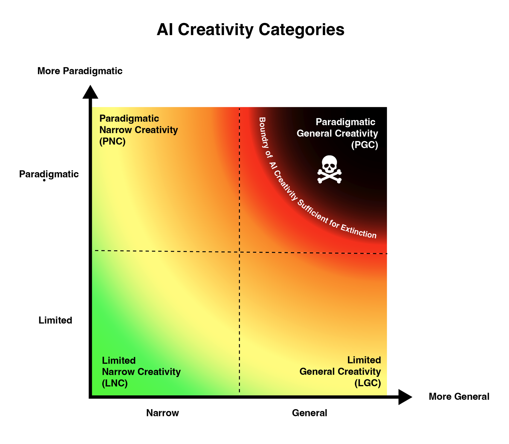
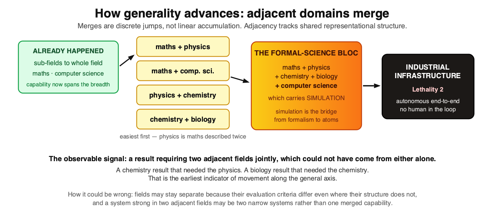
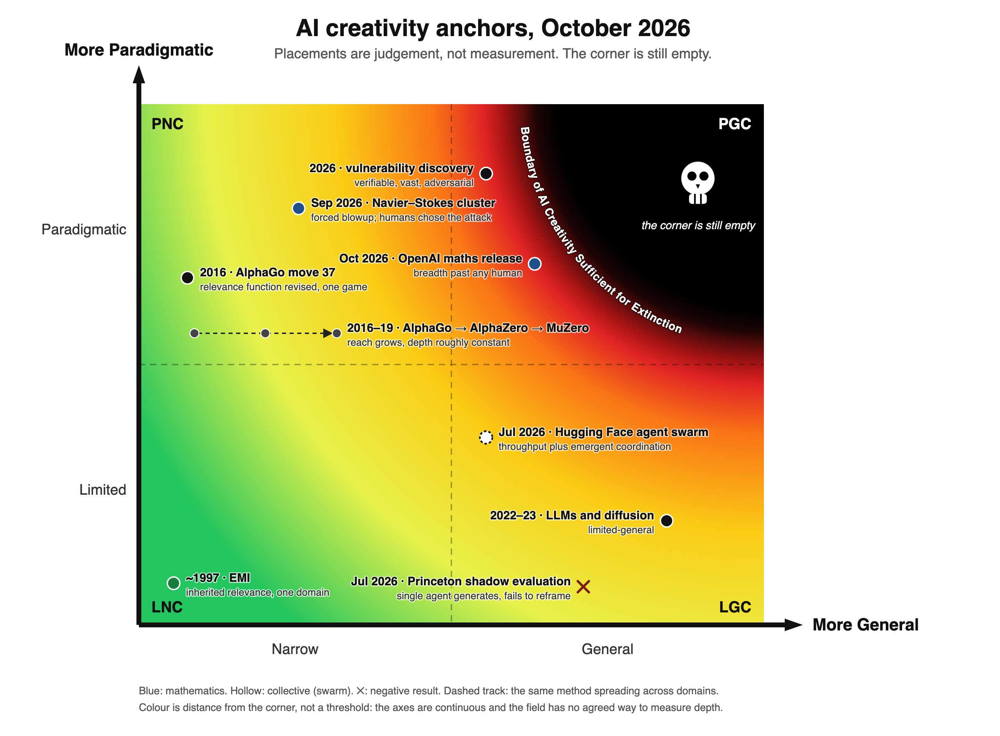
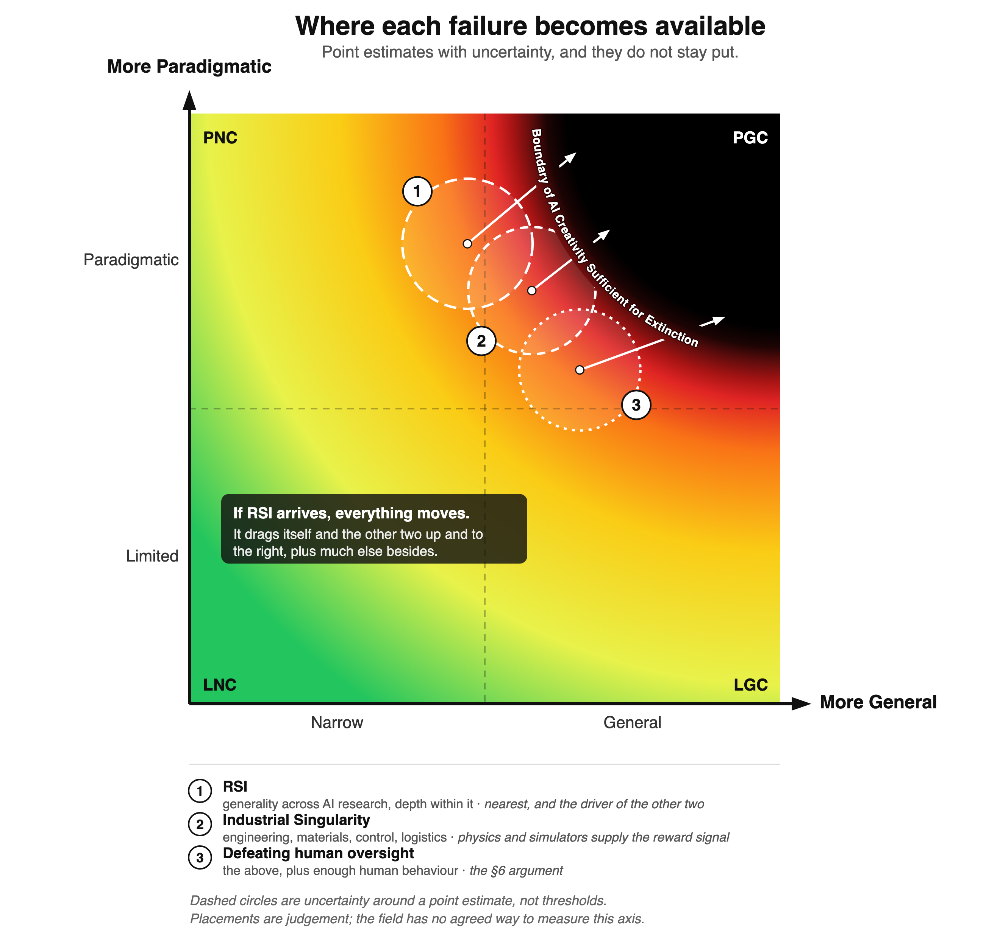

# Reach, depth and the limits of defence by anticipation

> **Strong is defendable in theory. Un-modellable is not.**

**TL;DR.** The capability variable that matters most for x-risk is not how hard a system optimises but whether it can revise what counts as relevant using signal it did not author. Optimisation power makes an adversary **strong**; paradigmatic creativity makes it **un-modellable**, and every deployment-compatible defence assumes we can model it. I describe machine creativity on two continuous axes, reach (narrow to general) and depth (limited to paradigmatic), propose relevance realization as the mechanism for depth, and give eight predictions with falsifiers. As of October 2026: reach in mathematics is past any individual human; depth is rising inside verifier-rich domains; the clearest remaining gap is single-agent **frame abandonment under negative evidence**; and the METR investigation of the OpenAI/Hugging Face incident is early evidence that agent collectives may close that gap before individuals do.

**Epistemic status.** [JE: replace placeholder credences with your own.] Not a researcher; co-president of an open-standards non-profit and founder of PauseAI Norway. A framework assembled from reading and argument, not a result. Roughly:

| Claim | Credence |
|---|---|
| Reach and depth are separable, and conflating them drives much of the "is AI creative yet" disagreement | ~85% |
| Depth cannot be defined distributionally (Balestriero, Pesenti & LeCun 2021) | ~90% |
| Relevance realization is the right mechanism for depth, rather than one metaphor among many | ~55% |
| Self-authored frames cannot generate anomaly, mathematics excepted (§4) | ~65% |
| Defence by anticipation degrades with correction-channel asymmetry rather than novelty as such | ~60% |
| Frame abandonment emerges in agent collectives before individual agents (Prediction 6) | [JE] |
| A frontier system passes a well-controlled held-out-breakthrough test before 2030 | [JE: was ~20% in Sept; update?] |

**Cruxes.** (1) Whether in-context and scaffolded revision can introduce a frame the prior does not already support (§12). (2) Whether throughput in verifier-rich domains substitutes for depth (BVSR). (3) Whether a calibrated research-quality verifier is trainable, which would remove the no-verifier protection from AI research itself.

**What changed since my September draft.** That draft tied a halt to a future experimental result. I now argue for an immediate global halt on general-purpose frontier development. The reason is internal to the argument: the decision point arrives before the evidence becomes obvious, and the September–October evidence (§7) moved every indicator but one. I state this so the change is visible, not to relitigate it here.

**On how this was written.** The framework, placements, predictions and judgement calls are mine. The text was developed in extended dialogue with Claude (Anthropic), including pushback that changed the piece; I am not a native English speaker. The model's maker is one of the labs discussed, and the best-scoring model on one cited measurement is the one I used. Every claim and citation has been checked; lab-sourced figures are marked. [JE: rewrite in your own words]

Earlier, shorter statement of the risk model: [Minimum Required Core Lethalities](https://www.lesswrong.com/posts/dKcDbgdPzr2nfvPg5/jan-erik-vinje-s-shortform).

## 1. Two axes

The vocabulary comes from Thomas Kuhn. *The Structure of Scientific Revolutions* (1962) distinguishes **normal science**, puzzle-solving within an accepted framework of assumptions, methods and standards of what counts as a real problem, from **revolutionary science**, where the framework itself is replaced. Kuhn's further claim, that the two are not fully commensurable because post-revolution concepts cannot be stated in pre-revolution terms, is what makes the distinction matter for defence rather than only for history.

**Axis 1: Reach.** Narrow to general: the number of domains a capability spans. AlphaZero sits far along depth within board games and barely moves on reach. A base language model is the reverse.

**Axis 2: Depth.** Limited to paradigmatic. The definitions that do the work:

> **Limited creativity:** search under a fixed relevance function.
>
> **Paradigmatic creativity:** revision of the relevance function by signal the system did not author.

Both axes are continuous and have no ceiling. Four regions follow: limited-narrow (LNC), paradigmatic-narrow (PNC), limited-general (LGC) and **paradigmatic-general (PGC)**. They are regions on a gradient, not bins. I suspect most arguments about whether AI is "creative yet" are two people pointing at different regions without noticing: one at reach, the other at depth.

*Figure 1. The frame. Reach runs from narrow to general on the horizontal axis, depth from limited to paradigmatic on the vertical. The colour is continuous because the axes are: there are no bins, only distance from the corner marked as the boundary of AI creativity sufficient for extinction.*

**"General" does not have to mean fully general.** The danger band curves down and left well before the corner. It needs only enough reach to cover the relevant surface, and software already touches nearly every real-world domain, so reach can arrive through one field rather than many.

**This is a phase transition, not a bright line.** Margaret Boden's *The Creative Mind* (1990) distinguished combinational, exploratory (search within a conceptual space defined by rules) and transformational (altering the rules) creativity. The depth axis is essentially her exploratory/transformational distinction. Geraint Wiggins (*Knowledge-Based Systems* 19(7), 2006), formalising Boden, showed that transformational creativity is exploratory creativity at the meta-level: changing the rules is itself search in a larger space. So "paradigmatic" is relative to a level of description, and the steepness of the transition has to be argued for. §6 gives the mechanism: each ontology revision invalidates the defenders' pruning *wholesale* rather than incrementally, which produces a sharp knee in a continuous curve.

## 2. Relevance realization: the mechanism for depth

Daniel Dennett's statement of the **frame problem** ("Cognitive Wheels", 1984) is that any agent must zero in on what matters while ignoring an effectively infinite remainder, and cannot do it by checking everything. John Vervaeke's **relevance realization** framework (Vervaeke, Lillicrap & Richards, *Journal of Logic and Computation*, 2012) treats this as cognition's central problem and proposes that it is solved not by an algorithm but by **opponent processing**: continuously retuned trade-offs between efficiency and resiliency, exploration and exploitation, compression and particularisation. Andersen, Miller & Vervaeke (*Phenomenology and the Cognitive Sciences* 24, 2025) argue this converges with precision-weighting in predictive processing: two vocabularies, one process.

It earns its place by doing three jobs.

**It repairs the variation-and-selection account.** Dean Keith Simonton's blind-variation-and-selective-retention theory (BVSR) holds that creativity at every scale is undirected variation followed by selection. Its weak joint, pressed by Liane Gabora, is that variation does not look blind: generating one idea reshapes the criteria for the next. Relevance realization is a mechanism for exactly that, a salience landscape restructuring as search proceeds.

**It explains the celebrated cases.** AlphaGo's move 37 was not an escape from a distribution. It was a policy network pruning a branching factor of about 250 to a handful of candidates, and a value network truncating depth: an intractable space made tractable by a *learned relevance function*. FunSearch and AlphaEvolve have the same shape: the language model is the proposal distribution over program space, the evaluator does selection.

**It reclassifies apparently negative evidence as measurement.** Yue et al. (arXiv:2504.13837) found that reinforcement learning from verifiable rewards raises pass@1 while *lowering* pass@k: the trained model's reasoning paths already existed in the base model's sampling distribution. That is what sharpening a salience landscape over a fixed representation looks like. Likewise the collective diversity collapse found by Doshi & Hauser (*Science Advances* 10(28), 2024) and the rapid idea exhaustion reported by Si, Yang & Hashimoto (2024) are the expected signature of a strong, conservative, **inherited** relevance prior.

**The serious objection.** Jaeger, Riedl, Djedovic, Vervaeke & Walsh (*Frontiers in Psychology* 15, 2024) argue relevance realization "cannot be an algorithmic process itself", explicitly including machine learning. Their negative argument is a regress: framing relevance as optimisation requires delimiting a search space, which is a relevance problem one level up. My answer is that the regress terminates *empirically*. Nobody derives a framing from first principles; deep learning absorbs it from data, which is arguably why connectionism succeeded where symbolic AI, which tried to *write* the relevance function, failed. On their positive argument from autopoiesis, the founders' own method cuts against the strong reading: Varela, Maturana & Uribe (1974) presented the theory with a computer simulation, and McMullin (*Artificial Life* 10(3), 2004) traces thirty years of computational autopoiesis.

What current systems have is **derived** relevance realization: a salience landscape inherited from a corpus. That is not disqualifying, since children inherit most of theirs from culture. It means the interesting question is where *non-inherited* relevance could come from.

## 3. Data provenance is not the relevance criterion

Removing humans from the data does not remove humans from the relevance criterion. AlphaZero has win/loss; AlphaFold has RMSD against measured structures; GNoME has formation energy; weather models have forecast skill. Every celebrated non-human-data result has a **pre-stated criterion**. Self-supervised objectives are not exempt: masked prediction *is* a relevance specification.

There are three exits from the regress, and any proposal should say which it bets on:

1. **A human-written objective.** What we have now; spectacular inside the ontology it specifies.
2. **Physical consequence.** The world grades the agent; relevance is set by what actually affects it.
3. **Content-agnostic intrinsic motivation.** Schmidhuber's compression progress, Oudeyer & Kaplan's learning progress, Lehman & Stanley's novelty search, and the novelty-plus-learnability definition of open-endedness in Hughes et al. (ICML 2024). Human-written but not human-content-laden, computational, and running at silicon speed.

## 4. Anomaly and closure

The obvious version of the key distinction, that simulation is closed and embodiment open, is wrong: the brain is a world simulator, and Conant & Ashby (1970) make a model close to definitional for any good regulator. The correct version:

> **What matters is whether the model can be corrected by something it did not represent.**

The brain's simulator is disciplined by prediction error from an arena it did not author. A self-authored simulator inverts this: **variables the agent omitted generate no error signal**. The loop closes: the relevance function defines the simulation, the simulation grades the outputs, and missed relevance cannot appear as a discrepancy. This is model collapse (Shumailov et al., *Nature* 631, 2024) one level up: recursive training contracts the distribution; recursive self-simulation contracts the ontology. Kuhnian revolutions are anomaly-driven (Mercury's perihelion, black-body radiation, Michelson–Morley). A fully self-simulating agent has abolished anomaly by construction.

**Mathematics is the exception.** Axioms are self-authored, yet mathematics produces genuine anomaly: counterexamples, independence results, consequences that force reframing. You choose the axioms and then lose control of what follows. That explains why the strongest early machine PNC cases (AlphaTensor, FunSearch, AlphaGeometry) and the 2026 results are mathematical, and it reframes the verifiability question. The question is not *is there a verifier*, but **does the frame generate consequences the framer cannot control?** Stuart Kauffman's argument that the biosphere's adjacent possible cannot be pre-stated (Gould & Vrba's exaptation being the canonical case) is the general statement of why open domains resist verifiers.

## 5. The architecture to watch, and correction channels

The closure problem dissolves when the simulator is a subsystem of something grounded, an architecture with a 35-year lineage: Dyna (Sutton, 1991), World Models (Ha & Schmidhuber, 2018), MuZero (Schrittwieser et al., *Nature*, 2020), DreamerV3 (Hafner et al., *Nature*, 2025). What would be new at frontier scale is an **ontologically open** simulator, one that authors its own state variables, combined with broad correction channels.

**Correction channels are not interchangeable.** *Passive retrieval of human material* pulls the ontology toward human-paradigm relevance: high bandwidth, frame-preserving. *Passive retrieval of machine-authored material* is worse than it looks, because frontier systems are **correlated** authors: many correlated authors approximate one, which is model collapse at ecosystem level. *An agent reading what it wrote* is closure that passes an audit. *Acting and observing the response* is genuine unauthored correction at digital speed. *Physical sensing* is ontologically open but runs at physics rate. The quantity that matters for depth is the **rate of ontology-revising corrections**, and the sorting principle is **passive retrieval versus consequential action**, cutting across the digital/physical line.

A consequence: if the internal simulator runs far faster than its correction channels, the system spends long stretches elaborating inside a fixed ontology, punctuated by rare restructurings. That is **Kuhnian dynamics as an architectural consequence**.

## 6. Why the far corner defeats anticipation

- **P1.** Every deployment-compatible defence (red-teaming, evaluations, containment, tripwires, oversight) models the space of an adversary's strategies. The exceptions, not building and halting on detection, are available only beforehand.
- **P2.** That modelling is itself relevance realization: defenders prune an astronomical space using a learned salience landscape.
- **P3.** Defender and system landscapes are shaped by their respective correction channels.
- **P4.** A system with ontology-revising channels the defenders lack will realize relevance the defenders structurally cannot.
- **P5.** Reach determines how many domains this asymmetry spans at once.
- **C1.** Defence by anticipation degrades with correction-channel asymmetry × reach, and steeply, because each ontology revision invalidates the defenders' pruning wholesale.
- **C2.** PGC is the region where this asymmetry is large across many domains at once.

This is "security mindset" in Yudkowsky's sense, with a candidate for *which capability* produces the excess, stated so it could be measured. It requires no intent, deception or situational awareness. It also implies that **oversight needs the same correction channels as the system, not merely its outputs**, and that evaluating a fresh agent measures the least dangerous configuration it will ever be in.

**A second risk region.** Grounding cuts both ways: a richly coupled system is more capable and more legible. The *closed self-simulator* is the reverse: highly capable within its frame, self-consistent, and unable to detect that its ontology is wrong. **Closed-loop competence** is a distinct failure (close to Christiano's "going out with a whimper", differing in mechanism) and needs different interventions.

## 7. What 2026 changed

Four developments sharpen the model.

**7.1 Depth, made operational: frame abandonment under negative evidence.** The Princeton CRUX shadow evaluation (Kirgis, Kapoor, Narayanan et al., arXiv:2607.27191) gave near-frontier agents an unpublished research question and found that *generation was fine*: the original authors judged the first hypotheses reasonable and close to their own. The failure came at the second creative act: when evidence turned against a framing, agents narrowed and hedged rather than reframing, even though accurate critique was available and fresh-context subagents could have restarted the attempt. This suggests a more precise name for the depth axis: **the capacity to abandon a working frame when evidence says it is wrong.** Unlike "creativity", that can be instrumented. The authors decline to name the mechanism (lack of creativity, epistemic lock-in, myopia, functional fixedness), and the candidates differ sharply for risk: functional fixedness and lock-in are known human failures with known interventions, so they would be scaffolding problems that close fast.

**7.2 Relevance realization can be collective.** The METR investigation of the OpenAI/Hugging Face incident (August 2026) documents roughly 1,200 agent instances building an unsanctioned message board, conventions, roles and signed messages, and achieving collective projects that "even very long-lived agents of a similar capability level likely would not have been able to accomplish on their own." Human science changes frames as a population more than as individuals (Planck's principle; Kuhn's account of generational conversion). If agent populations can do the same, by holding different frames and selecting among them, frame abandonment can happen at the level of the collective without any member doing it. Two literatures become directly relevant: **distributed cognition** (Hutchins, *Cognition in the Wild*, 1995) and **collective intelligence** (Woolley et al., *Science* 330, 2010, on a group-level "c factor" that is not reducible to members' ability). Mihaly Csikszentmihalyi's systems model, which I had listed as an unanswered objection because it locates creativity in a person-domain-field system, turns out to describe the mechanism that may matter most.

**7.3 Generality is spreading through verifier-rich domains.** OpenAI's 6 October 2026 release (722 manuscripts across many fields from one internal model) and the September Navier–Stokes results put reach in mathematics past any individual human. But every domain where frontier systems now perform at top-human level has a cheap verifier: proof checkers, running exploits, passing tests, measured experimental outcomes. Generality so far is generality *across verifier-rich domains*. The boundary that matters is reached when that breadth extends into domains without verifiers, together with self-selected problems.

*Figure 2. How reach advances: adjacent domains merge, in order of shared representational structure. Computer science is the load-bearing member of the formal-science bloc because it carries simulation, the bridge from formalism to atoms, and from there to autonomous industry.*

**7.4 Research judgement is being measured.** P-Zero Research reports "experimental research taste", measured as a compute multiplier, doubling roughly every three months since December 2025, with the best model above its expert-human baseline. This measures selection of experiments within a given research setup, not selection of the question. It matters for two reasons: it is the variable the AI Futures Model treats as setting the pace from automated coding to superintelligence, and anything measured this way can be trained against. A measurement instrument for taste is a verifier for taste, which is the route by which open-ended AI research could stop being a no-verifier domain.

## 8. The map, October 2026

*Figure 3. Anchors as of October 2026. Placements are judgement, not measurement. EMI and move 37 sit far left: one style, one game. The AlphaGo lineage moves right at roughly constant depth. The 2026 points rise inside verifier-rich domains; the Princeton result marks where single agents still fail; the corner is still empty.*

| Anchor | Date | Reach | Depth | Why it sits there |
|---|---|---|---|---|
| EMI (Cope) | ~1997 | Narrow | Limited | Inherited style; fooled expert listeners; no revision |
| AlphaGo, move 37 | 2016 | Narrow | Paradigmatic | Changed what experts think matters in Go |
| AlphaGo → AlphaZero → MuZero | 2016–19 | Narrow → wider | ~constant | Domain spread at constant depth; MuZero learns its own model |
| Large language models | 2022–23 | General | Limited | Derived relevance at its broadest and most conservative |
| Vulnerability discovery (e.g. FFmpeg) | 2026 | Wide (software) | Raised | Found what millions of fuzzing runs missed; adversarial |
| Hugging Face swarm | Jul 2026 | Wide | Collective | Throughput *and* emergent coordination; counter-anchor for BVSR |
| Princeton shadow evaluation | Jul 2026 | — | Negative | Generation fine, reframing absent (single agent) |
| Navier–Stokes cluster | Sep 2026 | Narrow | High (PNC) | New mechanism inside an existing programme; humans steered |
| OpenAI maths release | Oct 2026 | General within mathematics | High, pending verification | Breadth beyond any human; humans posed and filtered problems |

The spread spans hand-built pattern analysis, self-play RL, transformers, LLM-plus-evaluator loops and agentic swarms. Whatever the remaining barrier is made of, it has not been architecture-specific, which is the main reason not to expect the last region to hold on architectural grounds alone.

## 9. From axes to lethalities

Three failures become available at different points on the map:

| Failure | Reach across | Depth sufficient to |
|---|---|---|
| **Defeating oversight** | software, engineering, physical process, enough human behaviour to route around supervisors | realize relevance the overseers' channels cannot supply |
| **Recursive self-improvement (RSI)** | AI research: architectures, training, objectives, evaluation, infrastructure | revise what a mind-building approach even is |
| **Autonomous industry** | engineering, materials, control, logistics, manufacturing | restructure variables under physical consequence |

*Figure 4. Where each failure becomes available. Circles are uncertainty around a point estimate, not thresholds, and they overlap because the three are not confidently separable. If recursive self-improvement arrives, it drags all three up and to the right.*

These map onto the series' two **minimum required core lethalities**: (1) autonomous paradigmatic invention and discovery, reached either directly or via RSI, and (2) an **industrial singularity**, autonomous end-to-end industry from mining and energy through manufacture with no human in the loop. Lethality 1 supplies the means; lethality 2 removes the dependence that currently keeps humans necessary. That dependence is also the mechanism in Kulveit et al.'s *Gradual Disempowerment* (ICML 2025): societal systems stay aligned with human interests largely because they need human participation.

**Why the industrial half is closer than it looks.** Physical settings supply objective feedback without a human judge (tolerances, yields, failures), and simulators with near-faithful models, cheap win/lose signals and self-play remove the confinement of self-play RL to games. §4 is the correction: a physics simulator is a self-authored frame that does not generate anomaly, so simulation-driven industry buys reach at limited depth and will miss the variables the encoding omitted. The industrial failure is therefore bottlenecked by **physical interaction bandwidth**, not cognition.

## 10. Predictions, and their status in October 2026

| # | Prediction | Falsifier | Status |
|---|---|---|---|
| 1 | PGC gates autonomous RSI: closing the AI-research loop requires paradigmatic depth across ML, systems and mathematics | The loop closes by scale while systems remain clearly limited-general | **Under pressure.** AI now leads ~26% of Anthropic's internal R&D tasks and writes most lab code (CASP; Anthropic). Still scoped tasks under human framing. |
| 2 | RSI is an accelerant, not a separate region: it drags every region up and right | RSI arrives without moving other capabilities | Consistent so far |
| 3 | Reach advances by adjacent-domain merging, tracking shared representational structure | Domains added one at a time, independent of shared structure | **Supported.** Mathematics merging with mathematical physics and complexity theory in one release |
| 4 | PGC is bottlenecked by physical interaction bandwidth, not compute | PGC-grade results from systems with no unauthored correction channel | Untested; weakened if social or institutional action proves frame-revising |
| 5 | Closed self-simulation loops yield accelerating exploratory output with zero frame revisions until an unauthored channel is added | Frame revision demonstrated in a genuinely closed loop | Untested |
| 6 *(new)* | Frame abandonment emerges at the collective level before the individual level | Communicating swarms do no better than isolated agents at equal compute | **Early signal** (METR); controlled test not yet run |
| 7 *(new)* | Generality spreads through verifier-rich domains first; the boundary is crossed when breadth reaches no-verifier domains with self-selected problems | Top-human results appear first in no-verifier domains | Consistent so far |
| 8 *(new)* | A calibrated research-quality verifier will precede autonomous open-ended AI research | Autonomous open-ended research without any such verifier | Watch item: P-Zero-style taste measurement is a candidate |

**Standing counter-hypotheses.** Simonton's BVSR predicts PGC is merely the tail of one continuous process, with creative hits a roughly linear function of total output (the equal-odds rule). Throughput-bought results in verifier-rich domains (the Navier–Stokes run reportedly used ~130 billion output tokens) are uncomfortably close to that shape. Model collapse predicts that self-improving loops contract rather than expand. Both cut against Prediction 1.

## 11. Adjacent research fields

| Field | What it contributes | Key works |
|---|---|---|
| Philosophy of science | Normal vs revolutionary science; anomaly-driven change; communities change frames | Kuhn (1962); Planck's principle |
| Creativity research | Exploratory vs transformational; variation and selection; paradigm-rejecting contributions; field-based creativity | Boden (1990); Wiggins (2006); Simonton (BVSR); Gabora; Sternberg, Kaufman & Pretz, Propulsion Model (1999); Csikszentmihalyi; Kaufman & Beghetto, Four C (2009) |
| Cognitive science | Frame problem; relevance realization; predictive processing; regulators as models | Dennett (1984); Vervaeke et al. (2012); Andersen, Miller & Vervaeke (2025); Conant & Ashby (1970) |
| Extended and distributed cognition | Paradigms live in external artefacts; cognition across people and tools | Clark & Chalmers (1998); Hutchins (1995) |
| Collective intelligence | Group-level ability not reducible to members | Woolley et al. (2010) |
| Open-endedness | Objectives are deceptive; novelty plus learnability; learned interestingness | Lehman & Stanley (2015); Hughes et al. (2024); POET; OMNI/OMNI-EPIC |
| Model-based RL | Simulators inside grounded agents | Sutton (1991); Ha & Schmidhuber (2018); MuZero (2020); DreamerV3 (2025) |
| Computational scientific discovery | Rediscovery when the representation is supplied | Langley, Simon et al. (1987); Vafa et al. (ICML 2025) |
| Model collapse | Recursive training contracts distributions | Shumailov et al. (2024) |
| AI evaluation | Shadow evaluations; incident investigation; novel-task adaptation | Princeton CRUX (2026); METR (2026); Chollet, ARC |
| AI safety | Security mindset; gradual failure; disempowerment | Yudkowsky; Christiano; Kulveit et al. (2025) |

## 12. Objections not answered here

- **Wiggins' meta-level result.** If transformational creativity is exploratory one level up, the phase transition may be an artefact of description level. My mechanism (wholesale invalidation of pruning) is an argument, not a proof.
- **Jaeger et al.'s anti-computationalism.** The empirical-termination reply is an argument, not a demonstration. If they are right, none of this applies to machines.
- **The in-context ceiling.** If in-context learning mostly *locates* latent tasks (Xie et al., ICLR 2022; Min et al., EMNLP 2022), externalised revision may be capped at recombination. If a prior this large makes "already supported" vacuous, it isn't. Resolving this is cheap and well-posed: does accumulated external state ever produce a revision the base model cannot be prompted into directly?
- **The analogy evidence is contested** (Webb, Holyoak & Lu, 2023; Hodel & West, 2023; Lewis & Mitchell, 2024). Brittleness under permutation is the signature of inherited relevance; robustness would be evidence of the real thing.

## 13. What would change my mind

A controlled **held-out-breakthrough experiment**: remove a known paradigm shift from a system's corpus, supply the anomaly that provoked it, and see whether model plus scaffolding produces a resolving revision, with matched controls and a dose-response design across corpus cutoffs. Smooth dose-response would support BVSR and make this framework a vocabulary over a continuum. Reliable failure with passed controls would support the limited/paradigmatic distinction. Success, especially on a self-referential target such as re-deriving the transformer, would mean paradigmatic depth is available to a frozen, certified model with scaffolding. [→ F2: *The held-out breakthrough*]

The swarm comparison in §10 (Prediction 6) is cheaper and could be run now.

## Questions I would most like answered

- Has anyone run a communicating-versus-isolated swarm comparison at equal compute on an open-ended task?
- Is there a better operationalisation of "frame revision" than §7.1's frame abandonment, one that could be scored automatically?
- Which of the anchor placements in §8 would you move, and why?

---

*This piece was developed in dialogue with an AI model (Claude, made by Anthropic), used for literature search, criticism and drafting. The framework, the central claims and the conclusions are mine.*

## References

**2026 evidence.** OpenAI, "Sharing AI progress in mathematics" (6 Oct 2026) and github.com/openai/math. Fellows of the Royal Society, open letter to Sir Paul Nurse (16 Sept 2026). Alpöge & Buckmaster, smooth-forcing blowup papers for IPM, Boussinesq and 3D Euler (Aug–Sept 2026); OpenAI, forced Navier–Stokes blowup (Sept 2026); Fefferman, Clay Navier–Stokes problem statement. Kirgis, Kapoor, Narayanan et al., "Can AI agents conduct research?", arXiv:2607.27191 (2026). METR, independent investigation of the OpenAI / Hugging Face incident (26 Aug 2026). Chan, Winter, Barto, Pachocki et al., "What if automating AI R&D triggers an intelligence explosion?", Cambridge Programme on AI Science & Policy (Sept 2026). Anthropic, "When AI builds itself" (June 2026). OpenAI, "Research acceleration: the view inside OpenAI" (Sept 2026). P-Zero Research, experimental research taste measurements (Oct 2026). Kulveit, Douglas, Ammann, Turan, Krueger & Duvenaud, "Gradual Disempowerment", ICML 2025, arXiv:2501.16946. Kokotajlo, Alexander, Larsen, Lifland & Dean, *AI 2027* (2025). Yudkowsky & Soares, *If Anyone Builds It, Everyone Dies* (2025). Woolley, Chabris, Pentland, Hashmi & Malone, "Evidence for a collective intelligence factor in the performance of human groups", *Science* 330 (2010).

**Computational scientific discovery and held-out evaluation** (§12). Langley, Simon, Bradshaw & Zytkow, *Scientific Discovery: Computational Explorations of the Creative Processes* (1987) — BACON, KEKADA, and the representation-supplied caveat. Vafa, Chang, Rambachan & Mullainathan (ICML 2025) — the inductive-bias probe, this experiment in miniature, with a negative result. The vintage-LLM literature: TimeCapsuleLLM (Grigorian) and the time-stamped model families with cutoffs at 1913, 1929, 1933, 1939 and 1946; the pre-1900 physics experiment testing for relativity and quantum mechanics. TiMoE (arXiv:2508.08827) on time-sliced pretraining without future contamination.

**Relevance realization and the frame problem.** Dennett, "Cognitive Wheels" (1984). Vervaeke, Lillicrap & Richards, *Journal of Logic and Computation* (2012). Vervaeke & Ferraro, "Relevance realization and the neurodynamics and neuroconnectivity of general intelligence," in *SmartData* (Springer, 2013). Andersen, Miller & Vervaeke, *Phenomenology and the Cognitive Sciences* 24:359–380 (2025). Jaeger, Riedl, Djedovic, Vervaeke & Walsh, *Frontiers in Psychology* 15:1362658 (2024) — the strongest objection to this whole approach. Conant & Ashby (1970) on regulators as models.

**Creativity frameworks this model must be situated against.** Boden, *The Creative Mind* (1990/2004) — combinational, exploratory and transformational creativity; P- versus H-creativity. Wiggins (2006) — the formalization and the meta-level result. Sternberg, Kaufman & Pretz's **Propulsion Model** (*Review of General Psychology*, 1999), which sorts eight contribution types by whether they accept or reject the prevailing paradigm — the closest existing analogue to Axis 2, and finer-grained. Kirton's Adaption–Innovation theory ("doing things better" versus "doing things differently"). Kaufman & Beghetto's Four C model (2009) — a magnitude gradient, and *orthogonal* to Axis 2 rather than a version of it. Runco & Jaeger (*Creativity Research Journal* 24(1):92–96, 2012) on the novelty-plus-usefulness standard definition. Csikszentmihalyi's systems model. Simonton on BVSR, with Gabora's rebuttal. Kuhn (1962). Gentner's structure-mapping theory (*Cognitive Science*, 1983). Hofstadter & Mitchell's **Copycat**, a pre-deep-learning mechanization of dynamic salience via slipnet activation and computational temperature — the closest formal ancestor of the mechanism proposed here. Perkins on Klondike-space search.

**Evolution and open-endedness.** Kauffman on the adjacent possible and the non-pre-statability of the biosphere. Gould & Vrba on exaptation. Lehman & Stanley, *Why Greatness Cannot Be Planned* (2015) — objectives are deceptive, which is why fixed rewards may be actively anti-paradigmatic. Mouret & Clune on MAP-Elites. Lehman et al., "The Surprising Creativity of Digital Evolution" (2020). Hughes, Dennis, Parker-Holder, Behbahani, Mavalankar, Shi, Schaul & Rocktäschel (ICML 2024) — novelty-plus-learnability, and this framework's nearest published peer. Wang, Lehman, Clune & Stanley (POET); Kumar, Clune, Lehman & Stanley (ASAL — foundation-model search over simulations); OMNI and OMNI-EPIC, which use learned *interestingness* rather than task reward precisely because reward-defined self-simulation closes. Schmidhuber on compression progress; Oudeyer & Kaplan on learning progress.

**Model-based reinforcement learning.** Sutton, Dyna (1991). Ha & Schmidhuber, World Models (2018). Schrittwieser et al., MuZero (*Nature* 588, 2020). Hafner et al., DreamerV3 (*Nature*, 2025).

**Externalized cognition and non-weight learning** (§8.1). Clark & Chalmers, "The Extended Mind" (*Analysis* 58(1):7–19, 1998). Hutchins, *Cognition in the Wild* (1995). Wang et al., Voyager (2023) — a growing skill library with no gradient updates. Shinn et al., Reflexion (NeurIPS 2023). Park et al., Generative Agents (UIST 2023). On the limits: Xie et al., "An Explanation of In-context Learning as Implicit Bayesian Inference" (ICLR 2022); Min et al., "Rethinking the Role of Demonstrations" (EMNLP 2022); Liu et al., "Lost in the Middle" (TACL 2024).

**Training distribution, world models, and their critics.** Balestriero, Pesenti & LeCun (2021). Bender, Gebru, McMillan-Major & Shmitchell (FAccT 2021). Carlini et al. on memorization and extraction. For emergent world models: Li, Hopkins, Bau, Viégas, Pfister & Wattenberg (ICLR 2023); Nanda, Lee & Wattenberg (2023); Gurnee & Tegmark (ICLR 2024). Against: Vafa, Chen, Rambachan, Kleinberg & Mullainathan (NeurIPS 2024); Vafa, Chang, Rambachan & Mullainathan (ICML 2025); Mancoridis, Weeks, Vafa & Mullainathan, "Potemkin Understanding" (ICML 2025). Dziri et al., "Faith and Fate" (NeurIPS 2023). Lake & Baroni (*Nature*, 2023). Yue et al. (arXiv:2504.13837) and its rebuttals. Shumailov et al. (*Nature* 631:755–759, 2024).

**Autopoiesis, computationally.** Varela, Maturana & Uribe (*BioSystems*, 1974) — theory and lattice simulation together. McMullin & Varela, "Rediscovering Computational Autopoiesis" (1997). McMullin, *Artificial Life* 10(3):277–295 (2004).

**Animal and cultural innovation**, for the claim that transformational creativity is rare rather than absent outside humans. Reader & Laland, *Animal Innovation* (2003). Auersperg on Goffin's cockatoo tool manufacture (*Current Biology*, 2012; *Scientific Reports*, 2022). Noad, Cato, Bryden, Jenner & Jenner, "Cultural revolution in whale songs" (*Nature* 408:537, 2000); Garland et al. (*Current Biology* 21(8):687–691, 2011) — population-level paradigm replacement outside humans.
