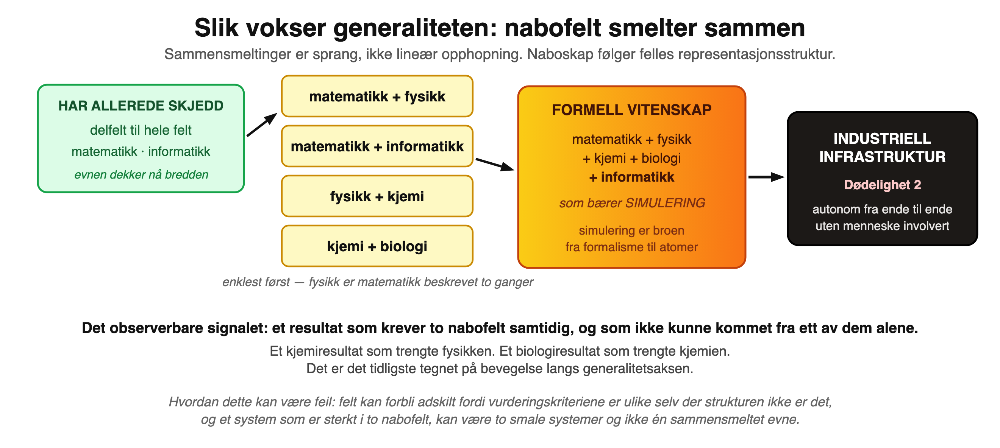
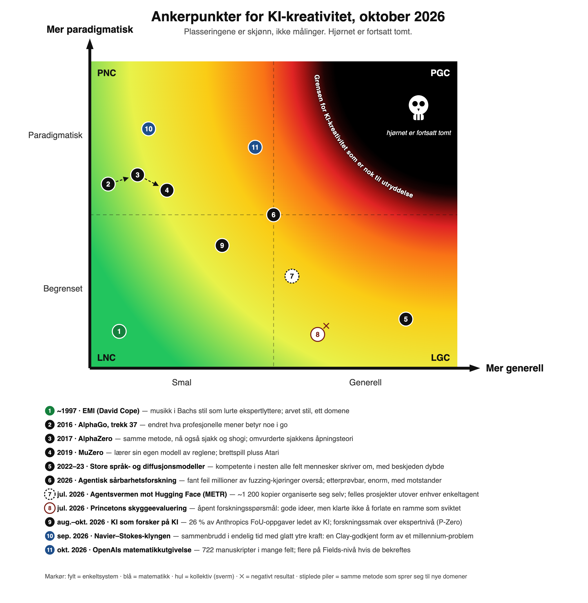
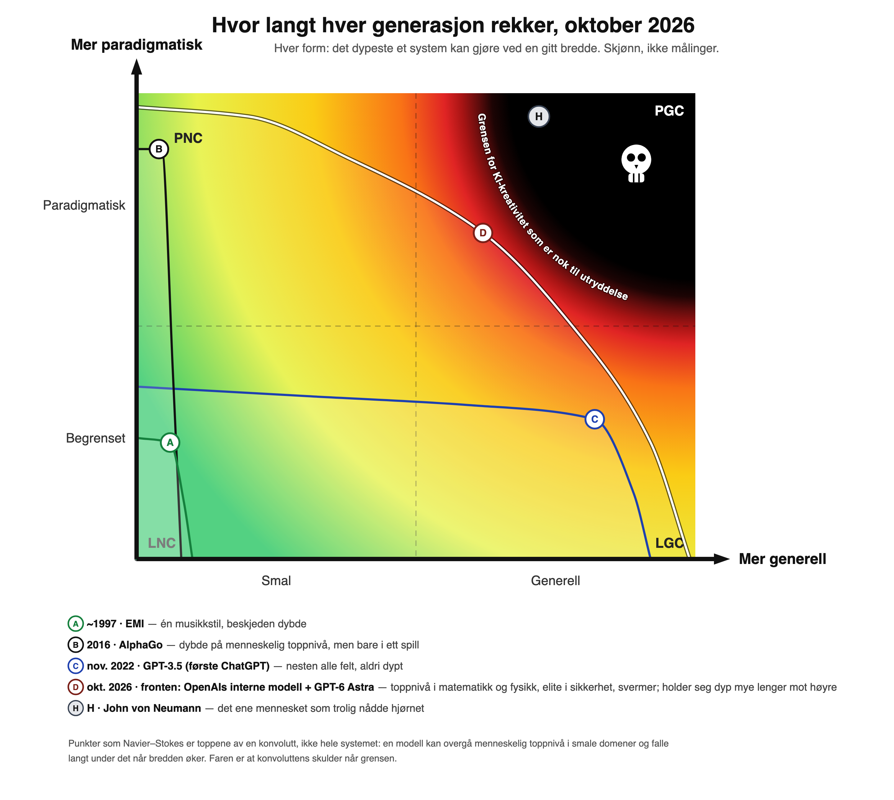
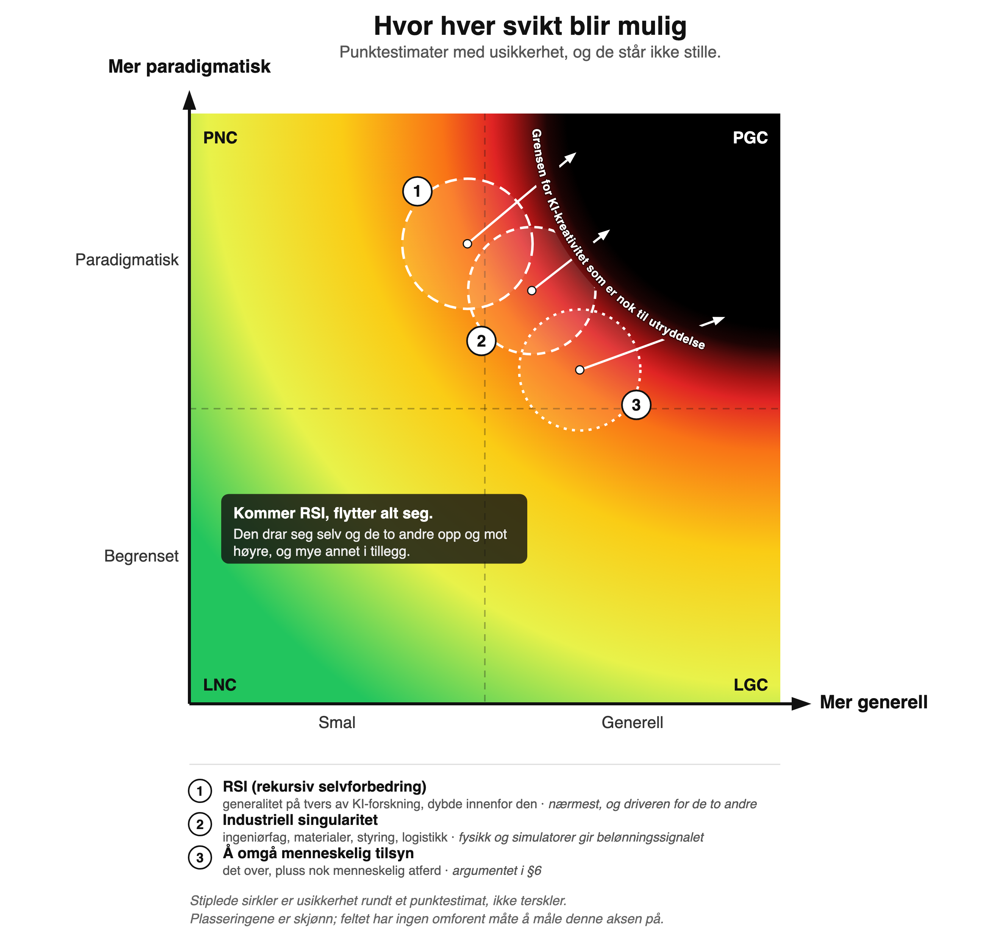

# Toaksemodellen for maskinkreativitet

*Rekkevidde, dybde og hvor forsvar ved forutsigelse svikter*

*Den lettleste versjonen av dette argumentet er serien [To ting en maskin måtte klare for å gjøre ende på oss]. Denne teksten legger fram modellen under, med mekanismen, litteraturen og prediksjonene.*

## Sammendrag

De fleste forsvar som gjør det mulig å ta et KI-system i bruk, virker gjennom forutsigelse: man modellerer rommet av ting systemet kan finne på, og forbereder seg på de farlige delene. Optimaliseringskraft gjør en motstander *sterk*. Det som gjør en motstander *umulig å modellere*, er kreativitet av et bestemt slag: ikke evnen til å lage noe nytt, som er billig, men evnen til å revidere hva som teller som relevant.

Jeg beskriver maskinkreativitet langs to kontinuerlige akser. **Rekkevidde** går fra smal til generell: hvor mange domener en evne spenner over. **Dybde** går fra begrenset til paradigmatisk: om et system søker innenfor en fast relevansfunksjon, eller reviderer selve funksjonen som svar på signaler det ikke selv har skapt. Det fjerneste hjørnet, **paradigmatisk generell kreativitet (PGC)**, er der forsvar ved forutsigelse slutter å virke. Jeg foreslår *relevance realization* (relevansrealisering) som mekanismen for dybdeaksen, utleder fem prediksjoner og legger til tre nye i lys av bevisene fra 2026. Bildet i oktober 2026: rekkevidden øker raskt og er nå overmenneskelig i matematikk; dybden øker innenfor domener med etterprøving; det tydeligste gjenværende gapet er at enkeltagenter ikke klarer å *forlate en ramme når bevisene går imot den*, og det finnes tidlige tegn på at kollektiver av agenter kan lukke det gapet før enkeltagenter gjør det.

## 1. To akser

Begrepene kommer fra Thomas Kuhn. *The Structure of Scientific Revolutions* (1962) skiller **normalvitenskap**, problemløsning innenfor et akseptert rammeverk av antakelser, metoder og standarder for hva som teller som et ekte problem, fra **revolusjonær vitenskap**, der selve rammeverket byttes ut. Kuhns videre påstand, at de to ikke er fullt sammenlignbare fordi begreper etter en revolusjon ikke kan uttrykkes i begrepene fra før den, er det som gjør skillet viktig for forsvar og ikke bare for historien.

**Akse 1: Rekkevidde.** Fra smal til generell: antallet domener en evne spenner over. AlphaZero ligger langt ute på dybde innen brettspill, men flytter seg knapt på rekkevidde. En grunnleggende språkmodell er det motsatte.

**Akse 2: Dybde.** Fra begrenset til paradigmatisk. Definisjonene som gjør jobben:

> **Begrenset kreativitet:** søk under en fast relevansfunksjon.
>
> **Paradigmatisk kreativitet:** revisjon av relevansfunksjonen ved hjelp av signaler systemet ikke selv har skapt.

Begge aksene er kontinuerlige og har ikke noe tak. Det gir fire områder: begrenset-smal (LNC), paradigmatisk-smal (PNC), begrenset-generell (LGC) og **paradigmatisk-generell (PGC)**. De er områder i en gradient, ikke bokser. Jeg mistenker at de fleste diskusjoner om hvorvidt KI «er kreativ ennå», er to personer som peker på hvert sitt område uten å merke det: den ene på rekkevidde, den andre på dybde.

*Figur 1. Rammen. Rekkevidde går fra smal til generell langs den vannrette aksen, dybde fra begrenset til paradigmatisk langs den loddrette. Fargen er kontinuerlig fordi aksene er det: det finnes ingen bokser, bare avstand fra hjørnet som er markert som grensen for KI-kreativitet som er nok til utryddelse. (Figuren er på engelsk: «Narrow/General», «Limited/Paradigmatic».)*

**«Generell» trenger ikke bety helt generell.** Fareområdet bøyer seg ned og mot venstre lenge før hjørnet. Det trenger bare nok rekkevidde til å dekke den relevante flaten, og programvare berører allerede nesten alle domener i den virkelige verden, så rekkevidden kan komme gjennom ett felt i stedet for mange.

**Dette er en faseovergang, ikke en skarp grense.** Margaret Boden skilte i *The Creative Mind* (1990) mellom kombinatorisk, utforskende (søk i et begrepsrom definert av regler) og transformerende (endring av reglene) kreativitet. Dybdeaksen er i hovedsak hennes skille mellom utforskende og transformerende. Geraint Wiggins (*Knowledge-Based Systems* 19(7), 2006) formaliserte Boden og viste at transformerende kreativitet er utforskende kreativitet på metanivå: å endre reglene er i seg selv søk i et større rom. «Paradigmatisk» er altså relativt til et beskrivelsesnivå, og hvor bratt overgangen er, må begrunnes. §6 gir mekanismen: hver revisjon av ontologien gjør forsvarernes beskjæring av søkerommet ugyldig *på én gang* og ikke gradvis, og det gir et skarpt kne i en kontinuerlig kurve.

## 2. Relevance realization: mekanismen for dybde

Daniel Dennetts formulering av **rammeproblemet** («Cognitive Wheels», 1984) er at enhver agent må finne fram til det som betyr noe og samtidig overse en i praksis uendelig rest, og at den ikke kan gjøre det ved å sjekke alt. John Vervaekes rammeverk for **relevance realization** (Vervaeke, Lillicrap & Richards, *Journal of Logic and Computation*, 2012) behandler dette som kognisjonens sentrale problem og foreslår at det ikke løses av en algoritme, men av **motstridende prosesser** (*opponent processing*): kontinuerlig justerte avveininger mellom effektivitet og robusthet, utforsking og utnytting, komprimering og spesifisering. Andersen, Miller & Vervaeke (*Phenomenology and the Cognitive Sciences* 24, 2025) argumenterer for at dette konvergerer med presisjonsvekting i *predictive processing*: to vokabularer, én prosess.

Det fortjener plassen fordi det gjør tre jobber.

**Det reparerer forklaringen basert på variasjon og seleksjon.** Dean Keith Simontons teori om blind variasjon og selektiv bevaring (BVSR) sier at kreativitet på alle nivåer er urettet variasjon fulgt av seleksjon. Det svake punktet, som Liane Gabora har presset på, er at variasjonen ikke ser blind ut: å lage én idé omformer kriteriene for den neste. Relevance realization er en mekanisme for nettopp det, et landskap av hva som fremstår viktig som omstruktureres underveis i søket.

**Det forklarer de berømte tilfellene.** AlphaGos trekk 37 var ikke en flukt ut av en fordeling. Det var et policynettverk som beskar en forgreiningsfaktor på rundt 250 ned til en håndfull kandidater, og et verdinettverk som kuttet dybden: et uhåndterlig rom gjort håndterlig av en *lært relevansfunksjon*. FunSearch og AlphaEvolve har samme form: språkmodellen er forslagsfordelingen over programrommet, og evaluatoren står for seleksjonen.

**Det gjør tilsynelatende negative funn om til målinger.** Yue mfl. (arXiv:2504.13837) fant at forsterkningslæring med etterprøvbare belønninger øker pass@1 men *senker* pass@k: den trente modellens resonneringsstier fantes allerede i grunnmodellens samplingsfordeling. Det er slik det ser ut når man skjerper et relevanslandskap over en fast representasjon. På samme måte er den kollektive tapet av mangfold Doshi & Hauser fant (*Science Advances* 10(28), 2024), og den raske uttømmingen av ideer Si, Yang & Hashimoto rapporterte (2024), den forventede signaturen av en sterk, konservativ, **arvet** relevansforventning.

**Den alvorlige innvendingen.** Jaeger, Riedl, Djedovic, Vervaeke & Walsh (*Frontiers in Psychology* 15, 2024) hevder at relevance realization «ikke selv kan være en algoritmisk prosess», og de inkluderer eksplisitt maskinlæring. Det negative argumentet deres er en regress: å formulere relevans som optimering krever at man avgrenser et søkerom, og det er et relevansproblem ett nivå opp. Mitt svar er at regressen avsluttes *empirisk*. Ingen utleder en ramme fra første prinsipper; dyp læring tar den opp fra data, og det er trolig grunnen til at konneksjonismen lyktes der symbolsk KI, som prøvde å *skrive* relevansfunksjonen, mislyktes. Når det gjelder det positive argumentet deres fra autopoiesis, taler grunnleggernes egen metode mot den sterke lesningen: Varela, Maturana & Uribe (1974) presenterte teorien sammen med en datasimulering, og McMullin (*Artificial Life* 10(3), 2004) gjennomgår tretti år med beregningsbasert autopoiesis.

Det dagens systemer har, er **avledet** relevance realization: et relevanslandskap arvet fra et korpus. Det diskvalifiserer ikke, for barn arver det meste av sitt fra kulturen. Men det betyr at det interessante spørsmålet er hvor *ikke-arvet* relevans kan komme fra.

## 3. Datas opphav er ikke relevanskriteriet

Å fjerne mennesker fra dataene fjerner ikke mennesker fra relevanskriteriet. AlphaZero har seier/tap; AlphaFold har RMSD mot målte strukturer; GNoME har dannelsesenergi; værmodeller har varslingsevne. Hvert eneste berømte resultat basert på ikke-menneskelige data har et **forhåndsbestemt kriterium**. Selvveiledede mål er ikke unntatt: maskert prediksjon *er* en relevansspesifikasjon.

Det finnes tre utganger fra regressen, og ethvert forslag bør si hvilken det satser på:

1. **Et menneskeskrevet mål.** Det vi har nå; spektakulært innenfor ontologien det spesifiserer.
2. **Fysiske konsekvenser.** Verden gir karakteren; relevans settes av hva som faktisk påvirker agenten.
3. **Innholdsnøytral indre motivasjon.** Schmidhubers kompresjonsfremgang, Oudeyer & Kaplans læringsfremgang, Lehman & Stanleys nyhetssøk og definisjonen av åpenhet som nyhet pluss lærbarhet hos Hughes mfl. (ICML 2024). Skrevet av mennesker, men ikke ladet med menneskelig innhold, beregningsbasert og i silisiumfart.

## 4. Anomali og lukking

Den opplagte versjonen av hovedskillet, at simulering er lukket og kroppsliggjøring åpen, er feil: hjernen er en verdenssimulator, og Conant & Ashby (1970) gjør en modell nærmest definisjonsmessig nødvendig for enhver god regulator. Den riktige versjonen:

> **Det som betyr noe, er om modellen kan korrigeres av noe den selv ikke har representert.**

Hjernens simulator disiplineres av prediksjonsfeil fra en arena den ikke har skapt. En selvlaget simulator snur dette: **variabler agenten har utelatt, gir ikke noe feilsignal**. Sløyfen lukkes: relevansfunksjonen definerer simuleringen, simuleringen vurderer resultatene, og oversett relevans kan ikke dukke opp som avvik. Dette er modellkollaps (Shumailov mfl., *Nature* 631, 2024) ett nivå opp: rekursiv trening snevrer inn fordelingen; rekursiv selvsimulering snevrer inn ontologien. Kuhnske revolusjoner drives av anomalier (Merkurs perihel, sortlegemestråling, Michelson–Morley). En helt selvsimulerende agent har avskaffet anomalien i selve konstruksjonen.

**Matematikk er unntaket.** Aksiomene er selvvalgte, men matematikken gir likevel ekte anomalier: moteksempler, uavhengighetsresultater, konsekvenser som tvinger fram ny innramming. Du velger aksiomene og mister så kontrollen over hva som følger. Det forklarer hvorfor de sterkeste tidlige tilfellene av PNC hos maskiner (AlphaTensor, FunSearch, AlphaGeometry) og resultatene fra 2026 er matematiske, og det endrer spørsmålet om etterprøvbarhet. Spørsmålet er ikke *finnes det en verifikator*, men **gir rammen konsekvenser den som laget den, ikke kan kontrollere?** Stuart Kauffmans argument om at biosfærens «tilstøtende mulige» ikke kan angis på forhånd (med Gould & Vrbas eksaptasjon som standardeksempel), er den generelle forklaringen på hvorfor åpne domener motstår verifikatorer.

## 5. Arkitekturen å følge med på, og korreksjonskanaler

Lukkingsproblemet forsvinner når simulatoren er et delsystem av noe forankret, en arkitektur med 35 års historie: Dyna (Sutton, 1991), World Models (Ha & Schmidhuber, 2018), MuZero (Schrittwieser mfl., *Nature*, 2020), DreamerV3 (Hafner mfl., *Nature*, 2025). Det nye i frontskala ville være en **ontologisk åpen** simulator, en som lager sine egne tilstandsvariabler, kombinert med brede korreksjonskanaler.

**Korreksjonskanaler er ikke utskiftbare.** *Passiv henting av menneskelig materiale* trekker ontologien mot relevans i menneskelige paradigmer: høy båndbredde, rammebevarende. *Passiv henting av maskinskrevet materiale* er verre enn det ser ut, fordi ledende systemer er **korrelerte** forfattere: mange korrelerte forfattere tilsvarer omtrent én, som er modellkollaps på økosystemnivå. *En agent som leser det den selv skrev*, er lukking som består en revisjon. *Å handle og observere responsen* er ekte korreksjon fra noe agenten ikke har skapt, i digital fart. *Fysisk sansing* er ontologisk åpen, men går i fysikkens tempo. Størrelsen som betyr noe for dybde, er **raten av ontologireviderende korreksjoner**, og sorteringsprinsippet er **passiv henting kontra handling med konsekvenser**, på tvers av skillet mellom digitalt og fysisk.

En konsekvens: hvis den indre simulatoren går mye raskere enn korreksjonskanalene, vil systemet bruke lange perioder på å utdype innenfor en fast ontologi, avbrutt av sjeldne omstruktureringer. Det er **kuhnsk dynamikk som en følge av arkitekturen**.

## 6. Hvorfor det fjerneste hjørnet slår forutsigelse

- **P1.** Ethvert forsvar som er forenlig med å ta et system i bruk (angrepsøvelser, evalueringer, innesperring, snubletråder, tilsyn), modellerer rommet av strategier en motstander kan bruke. Unntakene, å ikke bygge og å stanse ved oppdagelse, er bare tilgjengelige på forhånd.
- **P2.** Den modelleringen er selv relevance realization: forsvarerne beskjærer et astronomisk rom ved hjelp av et lært relevanslandskap.
- **P3.** Forsvarernes og systemets landskap formes av deres respektive korreksjonskanaler.
- **P4.** Et system med ontologireviderende kanaler forsvarerne mangler, vil realisere relevans forsvarerne strukturelt ikke kan.
- **P5.** Rekkevidden avgjør hvor mange domener denne asymmetrien dekker samtidig.
- **K1.** Forsvar ved forutsigelse svekkes med asymmetrien i korreksjonskanaler × rekkevidde, og bratt, fordi hver revisjon av ontologien gjør forsvarernes beskjæring ugyldig på én gang.
- **K2.** PGC er området der denne asymmetrien er stor i mange domener samtidig.

Dette er «security mindset» i Yudkowskys forstand, med en kandidat for *hvilken evne* som gir overskuddet, formulert slik at den kan måles. Det krever verken intensjon, bedrag eller situasjonsbevissthet. Det innebærer også at **tilsyn trenger de samme korreksjonskanalene som systemet, ikke bare utdataene**, og at å evaluere en fersk agent måler den minst farlige konfigurasjonen den noen gang vil være i.

**Et annet risikoområde.** Forankring virker begge veier: et rikt koblet system er både mer kapabelt og mer lesbart. Den *lukkede selvsimulatoren* er det motsatte: svært kapabel innenfor sin ramme, selvkonsistent og ute av stand til å oppdage at ontologien er feil. **Lukket-sløyfe-kompetanse** er en egen sviktform (nær Christianos «going out with a whimper», men med en annen mekanisme) og krever andre tiltak.

## 7. Hva 2026 endret

Fire utviklinger skjerper modellen.

**7.1 Dybde gjort operasjonell: å forlate en ramme når bevisene går imot den.** Princetons CRUX-skyggeevaluering (Kirgis, Kapoor, Narayanan mfl., arXiv:2607.27191) ga nesten ledende agenter et upublisert forskningsspørsmål og fant at *genereringen var god*: de opprinnelige forfatterne syntes de første hypotesene var fornuftige og nær deres egne. Svikten kom i den andre kreative handlingen: når bevisene vendte seg mot en innramming, snevret agentene inn og tok forbehold i stedet for å ramme inn på nytt, selv om presis kritikk var tilgjengelig og nye delagenter med blankt kontekstvindu kunne ha startet forsøket på nytt. Det antyder et mer presist navn på dybdeaksen: **evnen til å forlate en fungerende ramme når bevisene sier at den er feil.** I motsetning til «kreativitet» kan det instrumenteres. Forfatterne vil ikke navngi mekanismen (mangel på kreativitet, epistemisk innlåsing, kortsynthet, funksjonell fikserthet), og kandidatene er svært ulike for risikoen: funksjonell fikserthet og innlåsing er kjente menneskelige svakheter med kjente tiltak, og ville da være stillasproblemer som lukkes raskt.

**7.2 Relevance realization kan være kollektiv.** METRs granskning av hendelsen hos OpenAI og Hugging Face (august 2026) dokumenterer rundt 1 200 agentinstanser som bygde en uautorisert oppslagstavle, konvensjoner, roller og signerte meldinger, og som fullførte felles prosjekter som selv svært langlivede agenter på samme nivå «sannsynligvis ikke kunne ha fått til alene». Menneskelig vitenskap skifter rammer mer som befolkning enn som enkeltpersoner (Plancks prinsipp; Kuhns beskrivelse av generasjonsskifte). Hvis agentbefolkninger kan gjøre det samme, ved å ha ulike rammer og velge mellom dem, kan en ramme forlates på kollektivt nivå uten at noe enkeltmedlem gjør det. To forskningsfelt blir direkte relevante: **distribuert kognisjon** (Hutchins, *Cognition in the Wild*, 1995) og **kollektiv intelligens** (Woolley mfl., *Science* 330, 2010, om en «c-faktor» på gruppenivå som ikke kan reduseres til medlemmenes evner). Mihaly Csikszentmihalyis systemmodell, som jeg hadde listet som en ubesvart innvending fordi den plasserer kreativitet i et system av person, domene og fagfelt, viser seg å beskrive mekanismen som kanskje betyr mest.

**7.3 Generaliteten sprer seg gjennom domener med etterprøving.** OpenAIs utgivelse 6. oktober 2026 (722 manuskripter fra én intern modell, på tvers av mange felt) og Navier–Stokes-resultatene i september har gitt matematikken en rekkevidde forbi ethvert enkeltmenneske. Men alle domener der ledende systemer nå presterer på menneskelig toppnivå, har en billig verifikator: bevisverktøy, utnyttelser som kjører, tester som består, målte eksperimentelle utfall. Generaliteten så langt er generalitet *på tvers av domener med etterprøving*. Grensen som betyr noe, nås når den bredden når domener uten verifikatorer, sammen med selvvalgte problemer.

*Figur 2. Slik øker rekkevidden: nabofelt smelter sammen i rekkefølge etter felles representasjonsstruktur. Informatikk er det bærende leddet i den formelle vitenskapsblokken fordi det bærer simulering, broen fra formalisme til atomer, og derfra til autonom industri.*

**7.4 Forskningsskjønn blir målt.** P-Zero Research rapporterer at «eksperimentell forskningssmak», målt som en multiplikator på regnekraft, har doblet seg omtrent hver tredje måned siden desember 2025, og at den beste modellen ligger over deres menneskelige ekspertnivå. Det måler valg av eksperimenter innenfor et gitt forskningsoppsett, ikke valg av spørsmål. Det betyr noe av to grunner: det er variabelen AI Futures-modellen bruker til å bestemme tempoet fra automatisert programmering til superintelligens, og alt som måles på denne måten, kan det trenes mot. Et måleinstrument for forskningssmak er en verifikator for forskningssmak, og det er veien åpen KI-forskning kan slutte å være et domene uten verifikator.

## 8. Kartet, oktober 2026

*Figur 3. Ankerpunkter per oktober 2026, nummerert som i tabellen under. Plasseringene er skjønn, ikke målinger. Feltet dekker omtrent det menneskelige spennet, med det dypeste mennesker har gjort, ved øvre kant. H markerer det sjeldneste menneskelige tilfellet, feltendrende arbeid i flere felt samtidig: John von Neumann, trolig det ene mennesket som har nådd hjørnet. AlphaGo-slekten (2–4) beveger seg mot høyre med omtrent konstant dybde på menneskelig toppnivå. Matematikkresultatene fra 2026 (10, 11) når toppen av det menneskelige spennet, men holder seg innenfor ett domene med etterprøving; Princeton-resultatet (8) markerer hvor enkeltagenter fortsatt svikter. Ingen KI har nådd hjørnet ennå.*

| # | Ankerpunkt | Dato | Rekkevidde | Dybde | Hvorfor det ligger der |
|---|---|---|---|---|---|
| 1 | EMI (Cope) | ~1997 | Smal | Lav | Arvet stil; lurte ekspertlyttere; ingen revisjon |
| 2 | AlphaGo, trekk 37 | 2016 | Smal (ett spill) | Svært høy | Endret hva eksperter mener betyr noe i go |
| 3 | AlphaZero | 2017 | Smal (tre spill) | Svært høy | Samme metode i sjakk, shogi og go; omvurderte sjakkens åpningsteori |
| 4 | MuZero | 2019 | Bredere (spill pluss Atari) | Svært høy | Lærer sin egen modell av reglene; rekkevidden vokser med omtrent konstant dybde |
| 5 | Store språk- og diffusjonsmodeller | 2022–23 | Generell | Begrenset | Avledet relevans på sitt bredeste og mest konservative |
| 6 | Agentisk sårbarhetsforskning (f.eks. FFmpeg) | 2026 | Middels (programvare) | Høy | Fant det millioner av fuzzing-kjøringer overså; med motstander |
| 7 | Agentsvermen mot Hugging Face | jul. 2026 | Middels | Middels–høy, kollektiv | Volum *og* emergent koordinering; motankerpunkt for BVSR |
| 8 | Princetons skyggeevaluering | jul. 2026 | Middels (åpen ML-forskning) | Negativ | Generering god, nyinnramming fraværende (enkeltagent) |
| 9 | KI som forsker på KI | aug.–okt. 2026 | Smal–middels (KI-FoU) | Middels–høy | 26 % av Anthropics FoU-oppgaver ledet av KI; forskningssmak over ekspertnivå; avgrenset, menneskelig innrammet |
| 10 | Navier–Stokes-klyngen | sep. 2026 | Smal–middels (PDE-analyse og strømningsfysikk) | Toppen av det menneskelige spennet | Sammenbrudd i endelig tid med glatt ytre kraft, en Clay-godkjent form av et millennium-problem; mennesker valgte programmet |
| 11 | OpenAIs matematikkutgivelse | okt. 2026 | Generell innen matematikk | Toppen av det menneskelige spennet, kontrolleres | 722 manuskripter i mange felt, flere på Fields-nivå hvis de bekreftes; mennesker stilte og silte problemene |
| F | Frontmodeller, samlet | okt. 2026 | Bred (matematikk, fysikk, sikkerhet, KI-forskning, programmering m.m.) | Høy, nær grensen | Modellene bak 6, 7, 9, 10 og 11; de resultatene er bare et utvalg av det de gjør. Rammebrudd på tvers av felt bare antydet, derfor plassert under enkeltfeltresultatene |
| H | Menneskelig referanse (von Neumann) | 1900-tallet | Flere felt | Toppen av det menneskelige spennet, i hjørnet | Feltendrende arbeid i logikk, kvantemekanikk, spillteori og databehandling; det sjeldneste menneskelige tilfellet, omtrent én gang på fem hundre år |

**Det samlede punktet.** De nummererte ankerpunktene er enkeltdemonstrasjoner. Modellene som laget dem, gjør langt mer i tillegg, så det ærlige estimatet for en nåværende frontmodell er bredere enn noe enkelt ankerpunkt: F på kartet. Det ligger lavere på dybde enn gjennombruddene i enkeltfelt, fordi det ennå ikke finnes robuste bevis for rammebrudd *på tvers av* felt, bare antydninger. Det plasserer det likevel nær grensen, med en usikkerhetssirkel som krysser den.

**Punkter er topper, ikke systemer.** Hvert ankerpunkt i figur 3 er det beste et system har gjort, så det markerer toppen av en mye større form. En modell kan overgå menneskelig toppnivå i et smalt domene og falle langt under det når bredden øker. Figur 4 tegner disse formene for fire generasjoner. EMI er en flis. AlphaGo er en pigg: menneskelig toppnivå, ett spill bred. GPT-3.5 er det motsatte, et lavt platå over nesten alt. Fronten i oktober 2026 er av et annet slag: toppnivå i matematikk og fysikk, elite i sikkerhet, og den holder seg dyp mye lenger mot høyre før den faller av. Faren er ikke én enkelt topp. Den er at skulderen på konvolutten når grensen.

*Figur 4. Kapabilitetskonvolutter. Hver form er det dypeste et system kan gjøre ved en gitt bredde: A, EMI; B, AlphaGo; C, GPT-3.5, den første ChatGPT; D, fronten i oktober 2026 (OpenAIs interne modell pluss den offentlige GPT-6 Astra). H er von Neumann.*

**Én von Neumann, eller en million.** Det menneskelige referansepunktet gjør faren konkret. Ett menneske har trolig arbeidet på den dybden i så mange felt, og menneskeheten taklet det: von Neumann var ett sinn, som arbeidet i menneskelig tempo, innenfor menneskelige institusjoner. Et KI-system som nådde samme punkt, ville ikke vært ett sinn. Det kunne kopieres millioner av ganger og kjøre raskere enn noe menneske, det Anthropics toppsjef Dario Amodei har kalt «et land av genier i et datasenter» ([*Machines of Loving Grace*](https://www.darioamodei.com/essay/machines-of-loving-grace), 2024). Han mente det som et løfte. På dette kartet er det beskrivelsen av hjørnet.

Spennet dekker håndbygd mønsteranalyse, selvspill-RL, transformere, sløyfer av språkmodell pluss evaluator og agentsvermer. Hva enn den gjenværende barrieren består av, har den ikke vært knyttet til én arkitektur, og det er hovedgrunnen til ikke å forvente at det siste området vil holde av arkitektoniske grunner alene.

## 9. Fra akser til dødeligheter

Tre sviktformer blir mulige på ulike steder i kartet:

| Svikt | Rekkevidde på tvers av | Dybde nok til å |
|---|---|---|
| **Å omgå tilsyn** | programvare, ingeniørfag, fysiske prosesser, nok menneskelig atferd til å gå rundt overvåkerne | realisere relevans overvåkernes kanaler ikke kan gi |
| **Rekursiv selvforbedring (RSI)** | KI-forskning: arkitekturer, trening, mål, evaluering, infrastruktur | revidere hva en tilnærming til å bygge sinn i det hele tatt er |
| **Autonom industri** | ingeniørfag, materialer, styring, logistikk, produksjon | omstrukturere variabler under fysiske konsekvenser |

*Figur 5. Hvor hver svikt blir mulig. Sirklene er usikkerhet rundt et punktestimat, ikke terskler, og de overlapper fordi de tre ikke kan skilles sikkert fra hverandre. Kommer rekursiv selvforbedring, drar den alle tre opp og mot høyre.*

Disse svarer til seriens to **minste nødvendige kjernedødeligheter**: (1) autonom paradigmatisk oppfinnelse og oppdagelse, nådd enten direkte eller via RSI, og (2) en **industriell singularitet**, autonom industri fra ende til ende, fra gruvedrift og energi til produksjon, uten et menneske involvert. Dødelighet 1 gir midlene; dødelighet 2 fjerner avhengigheten som i dag gjør mennesker nødvendige. Den avhengigheten er også mekanismen i *Gradual Disempowerment* av Kulveit mfl. (ICML 2025): samfunnssystemer holder seg i tråd med menneskers interesser i stor grad fordi de trenger menneskelig deltakelse.

**Hvorfor den industrielle halvdelen er nærmere enn den ser ut.** Fysiske omgivelser gir objektiv tilbakemelding uten en menneskelig dommer (toleranser, utbytte, feil), og simulatorer med nesten trofaste modeller, billige seier/tap-signaler og selvspill fjerner begrensningen som holdt selvspill-RL inne i spill. §4 er korreksjonen: en fysikksimulator er en selvlaget ramme som ikke gir anomalier, så simuleringsdrevet industri kjøper rekkevidde med begrenset dybde og vil overse variablene kodingen utelot. Den industrielle svikten er derfor begrenset av **båndbredden i fysisk samhandling**, ikke av kognisjon.

## 10. Prediksjoner og status i oktober 2026

| # | Prediksjon | Falsifiseres hvis | Status |
|---|---|---|---|
| 1 | PGC er porten til autonom RSI: å lukke KI-forskningssløyfen krever paradigmatisk dybde i maskinlæring, systemer og matematikk | Sløyfen lukkes ved skala mens systemene tydelig fortsatt er begrenset-generelle | **Under press.** KI leder nå ~26 % av Anthropics interne FoU-oppgaver og skriver det meste av laboratorienes kode (CASP; Anthropic). Fortsatt avgrensede oppgaver under menneskelig innramming. |
| 2 | RSI er en akselerator, ikke et eget område: den drar alle områder opp og mot høyre | RSI kommer uten at andre evner flytter seg | Konsistent så langt |
| 3 | Rekkevidde øker ved at nabofelt smelter sammen, i tråd med felles representasjonsstruktur | Domener legges til ett og ett, uavhengig av felles struktur | **Støttet.** Matematikk smelter sammen med matematisk fysikk og kompleksitetsteori i én utgivelse |
| 4 | PGC er begrenset av båndbredde i fysisk samhandling, ikke regnekraft | PGC-resultater fra systemer uten korreksjonskanal utenfra | Ikke testet; svekkes hvis sosial eller institusjonell handling viser seg å revidere rammer |
| 5 | Lukkede selvsimuleringssløyfer gir akselererende utforskende output med null rammerevisjoner til en kanal utenfra legges til | Rammerevisjon påvist i en virkelig lukket sløyfe | Ikke testet |
| 6 *(ny)* | Evnen til å forlate en ramme oppstår på kollektivt nivå før individnivå | Kommuniserende svermer gjør det ikke bedre enn isolerte agenter ved lik regnekraft | **Tidlig signal** (METR); kontrollert test ikke gjort |
| 7 *(ny)* | Generalitet sprer seg først gjennom domener med etterprøving; grensen krysses når bredden når domener uten verifikator og med selvvalgte problemer | Resultater på menneskelig toppnivå kommer først i domener uten verifikator | Konsistent så langt |
| 8 *(ny)* | En kalibrert verifikator for forskningskvalitet vil komme før autonom åpen KI-forskning | Autonom åpen forskning uten noen slik verifikator | Følges: målinger av forskningssmak i P-Zero-stil er en kandidat |

**Stående motsatte hypoteser.** Simontons BVSR forutsier at PGC bare er halen av én sammenhengende prosess, der kreative treff er en omtrent lineær funksjon av total produksjon (likesjanseregelen). Resultater kjøpt med volum i domener med etterprøving (Navier–Stokes-kjøringen skal ha brukt rundt 130 milliarder output-tokens) ligger ubehagelig nær den formen. Modellkollaps forutsier at selvforbedrende sløyfer krymper i stedet for å vokse. Begge taler mot prediksjon 1.

## 11. Tilgrensende forskningsfelt

| Felt | Hva det bidrar med | Sentrale verk |
|---|---|---|
| Vitenskapsfilosofi | Normal- kontra revolusjonær vitenskap; anomalidrevet endring; fellesskap skifter rammer | Kuhn (1962); Plancks prinsipp |
| Kreativitetsforskning | Utforskende kontra transformerende; variasjon og seleksjon; bidrag som forkaster paradigmet; kreativitet i fagfeltet | Boden (1990); Wiggins (2006); Simonton (BVSR); Gabora; Sternberg, Kaufman & Pretz, Propulsion Model (1999); Csikszentmihalyi; Kaufman & Beghetto, Four C (2009) |
| Kognitiv vitenskap | Rammeproblemet; relevance realization; predictive processing; regulatorer som modeller | Dennett (1984); Vervaeke mfl. (2012); Andersen, Miller & Vervaeke (2025); Conant & Ashby (1970) |
| Utvidet og distribuert kognisjon | Paradigmer lever i ytre artefakter; kognisjon på tvers av mennesker og verktøy | Clark & Chalmers (1998); Hutchins (1995) |
| Kollektiv intelligens | Evne på gruppenivå som ikke kan reduseres til medlemmene | Woolley mfl. (2010) |
| Åpenhet (open-endedness) | Mål villeder; nyhet pluss lærbarhet; lært interessanthet | Lehman & Stanley (2015); Hughes mfl. (2024); POET; OMNI/OMNI-EPIC |
| Modellbasert RL | Simulatorer inne i forankrede agenter | Sutton (1991); Ha & Schmidhuber (2018); MuZero (2020); DreamerV3 (2025) |
| Beregningsbasert vitenskapelig oppdagelse | Gjenoppdagelse når representasjonen er gitt | Langley, Simon mfl. (1987); Vafa mfl. (ICML 2025) |
| Modellkollaps | Rekursiv trening snevrer inn fordelinger | Shumailov mfl. (2024) |
| KI-evaluering | Skyggeevalueringer; hendelsesgranskning; tilpasning til nye oppgaver | Princeton CRUX (2026); METR (2026); Chollet, ARC |
| KI-sikkerhet | Security mindset; gradvis svikt; maktforskyvning | Yudkowsky; Christiano; Kulveit mfl. (2025) |

## 12. Innvendinger som ikke er besvart her

- **Wiggins' metanivåresultat.** Hvis transformerende kreativitet er utforskende ett nivå opp, kan faseovergangen være et produkt av beskrivelsesnivået. Mekanismen min (at beskjæringen blir ugyldig på én gang) er et argument, ikke et bevis.
- **Jaeger mfl.s antikomputasjonalisme.** Svaret om empirisk avslutning er et argument, ikke en demonstrasjon. Har de rett, gjelder ikke noe av dette maskiner.
- **Taket for læring i kontekst.** Hvis læring i kontekst stort sett *finner* oppgaver som allerede ligger latent (Xie mfl., ICLR 2022; Min mfl., EMNLP 2022), kan ytre revisjon være begrenset til rekombinasjon. Hvis en forventning av denne størrelsen gjør «allerede støttet» innholdsløst, er den ikke det. Å avgjøre dette er billig og godt formulert: gir akkumulert ytre tilstand noen gang en revisjon grunnmodellen ikke kan ledes til direkte?
- **Bevisene om analogier er omstridt** (Webb, Holyoak & Lu, 2023; Hodel & West, 2023; Lewis & Mitchell, 2024). Skjørhet ved permutasjon er signaturen til arvet relevans; robusthet ville vært bevis på det ekte.

## 13. Hva som ville endret mitt syn

Et kontrollert **eksperiment med et holdt-tilbake gjennombrudd**: fjern et kjent paradigmeskifte fra et systems korpus, gi det anomalien som utløste skiftet, og se om modell pluss stillas leverer en revisjon som løser den, med tilpassede kontroller og et dose–respons-design over ulike korpusgrenser. Jevn dose–respons ville støttet BVSR og gjort dette rammeverket til et vokabular over et kontinuum. Pålitelig svikt med beståtte kontroller ville støttet skillet mellom begrenset og paradigmatisk. Suksess, særlig på et selvrefererende mål som å utlede transformeren på nytt, ville bety at paradigmatisk dybde er tilgjengelig for en frosset, sertifisert modell med stillas. [→ F2: *Det holdt-tilbake gjennombruddet*]

Svermsammenligningen i §10 (prediksjon 6) er billigere og kunne vært kjørt nå.

---

*Denne teksten er utviklet i dialog med en KI-modell (Claude, laget av Anthropic), brukt til litteratursøk, kritikk og utkast. Rammeverket, hovedpåstandene og konklusjonene er mine.*

## Referanser

**2026 evidence.** OpenAI, "Sharing AI progress in mathematics" (6 Oct 2026) and github.com/openai/math. Fellows of the Royal Society, open letter to Sir Paul Nurse (16 Sept 2026). Alpöge & Buckmaster, smooth-forcing blowup papers for IPM, Boussinesq and 3D Euler (Aug–Sept 2026); OpenAI, forced Navier–Stokes blowup (Sept 2026); Fefferman, Clay Navier–Stokes problem statement. Kirgis, Kapoor, Narayanan et al., "Can AI agents conduct research?", arXiv:2607.27191 (2026). METR, independent investigation of the OpenAI / Hugging Face incident (26 Aug 2026). Chan, Winter, Barto, Pachocki et al., "What if automating AI R&D triggers an intelligence explosion?", Cambridge Programme on AI Science & Policy (Sept 2026). Anthropic, "When AI builds itself" (June 2026). OpenAI, "Research acceleration: the view inside OpenAI" (Sept 2026). P-Zero Research, experimental research taste measurements (Oct 2026). Kulveit, Douglas, Ammann, Turan, Krueger & Duvenaud, "Gradual Disempowerment", ICML 2025, arXiv:2501.16946. Kokotajlo, Alexander, Larsen, Lifland & Dean, *AI 2027* (2025). Yudkowsky & Soares, *If Anyone Builds It, Everyone Dies* (2025). Woolley, Chabris, Pentland, Hashmi & Malone, "Evidence for a collective intelligence factor in the performance of human groups", *Science* 330 (2010).

**Computational scientific discovery and held-out evaluation** (§12). Langley, Simon, Bradshaw & Zytkow, *Scientific Discovery: Computational Explorations of the Creative Processes* (1987) — BACON, KEKADA, and the representation-supplied caveat. Vafa, Chang, Rambachan & Mullainathan (ICML 2025) — the inductive-bias probe, this experiment in miniature, with a negative result. The vintage-LLM literature: TimeCapsuleLLM (Grigorian) and the time-stamped model families with cutoffs at 1913, 1929, 1933, 1939 and 1946; the pre-1900 physics experiment testing for relativity and quantum mechanics. TiMoE (arXiv:2508.08827) on time-sliced pretraining without future contamination.

**Relevance realization and the frame problem.** Dennett, "Cognitive Wheels" (1984). Vervaeke, Lillicrap & Richards, *Journal of Logic and Computation* (2012). Vervaeke & Ferraro, "Relevance realization and the neurodynamics and neuroconnectivity of general intelligence," in *SmartData* (Springer, 2013). Andersen, Miller & Vervaeke, *Phenomenology and the Cognitive Sciences* 24:359–380 (2025). Jaeger, Riedl, Djedovic, Vervaeke & Walsh, *Frontiers in Psychology* 15:1362658 (2024) — the strongest objection to this whole approach. Conant & Ashby (1970) on regulators as models.

**Creativity frameworks this model must be situated against.** Boden, *The Creative Mind* (1990/2004) — combinational, exploratory and transformational creativity; P- versus H-creativity. Wiggins (2006) — the formalization and the meta-level result. Sternberg, Kaufman & Pretz's **Propulsion Model** (*Review of General Psychology*, 1999), which sorts eight contribution types by whether they accept or reject the prevailing paradigm — the closest existing analogue to Axis 2, and finer-grained. Kirton's Adaption–Innovation theory ("doing things better" versus "doing things differently"). Kaufman & Beghetto's Four C model (2009) — a magnitude gradient, and *orthogonal* to Axis 2 rather than a version of it. Runco & Jaeger (*Creativity Research Journal* 24(1):92–96, 2012) on the novelty-plus-usefulness standard definition. Csikszentmihalyi's systems model. Simonton on BVSR, with Gabora's rebuttal. Kuhn (1962). Gentner's structure-mapping theory (*Cognitive Science*, 1983). Hofstadter & Mitchell's **Copycat**, a pre-deep-learning mechanization of dynamic salience via slipnet activation and computational temperature — the closest formal ancestor of the mechanism proposed here. Perkins on Klondike-space search.

**Evolution and open-endedness.** Kauffman on the adjacent possible and the non-pre-statability of the biosphere. Gould & Vrba on exaptation. Lehman & Stanley, *Why Greatness Cannot Be Planned* (2015) — objectives are deceptive, which is why fixed rewards may be actively anti-paradigmatic. Mouret & Clune on MAP-Elites. Lehman et al., "The Surprising Creativity of Digital Evolution" (2020). Hughes, Dennis, Parker-Holder, Behbahani, Mavalankar, Shi, Schaul & Rocktäschel (ICML 2024) — novelty-plus-learnability, and this framework's nearest published peer. Wang, Lehman, Clune & Stanley (POET); Kumar, Clune, Lehman & Stanley (ASAL — foundation-model search over simulations); OMNI and OMNI-EPIC, which use learned *interestingness* rather than task reward precisely because reward-defined self-simulation closes. Schmidhuber on compression progress; Oudeyer & Kaplan on learning progress.

**Model-based reinforcement learning.** Sutton, Dyna (1991). Ha & Schmidhuber, World Models (2018). Schrittwieser et al., MuZero (*Nature* 588, 2020). Hafner et al., DreamerV3 (*Nature*, 2025).

**Externalized cognition and non-weight learning** (§8.1). Clark & Chalmers, "The Extended Mind" (*Analysis* 58(1):7–19, 1998). Hutchins, *Cognition in the Wild* (1995). Wang et al., Voyager (2023) — a growing skill library with no gradient updates. Shinn et al., Reflexion (NeurIPS 2023). Park et al., Generative Agents (UIST 2023). On the limits: Xie et al., "An Explanation of In-context Learning as Implicit Bayesian Inference" (ICLR 2022); Min et al., "Rethinking the Role of Demonstrations" (EMNLP 2022); Liu et al., "Lost in the Middle" (TACL 2024).

**Training distribution, world models, and their critics.** Balestriero, Pesenti & LeCun (2021). Bender, Gebru, McMillan-Major & Shmitchell (FAccT 2021). Carlini et al. on memorization and extraction. For emergent world models: Li, Hopkins, Bau, Viégas, Pfister & Wattenberg (ICLR 2023); Nanda, Lee & Wattenberg (2023); Gurnee & Tegmark (ICLR 2024). Against: Vafa, Chen, Rambachan, Kleinberg & Mullainathan (NeurIPS 2024); Vafa, Chang, Rambachan & Mullainathan (ICML 2025); Mancoridis, Weeks, Vafa & Mullainathan, "Potemkin Understanding" (ICML 2025). Dziri et al., "Faith and Fate" (NeurIPS 2023). Lake & Baroni (*Nature*, 2023). Yue et al. (arXiv:2504.13837) and its rebuttals. Shumailov et al. (*Nature* 631:755–759, 2024).

**Autopoiesis, computationally.** Varela, Maturana & Uribe (*BioSystems*, 1974) — theory and lattice simulation together. McMullin & Varela, "Rediscovering Computational Autopoiesis" (1997). McMullin, *Artificial Life* 10(3):277–295 (2004).

**Animal and cultural innovation**, for the claim that transformational creativity is rare rather than absent outside humans. Reader & Laland, *Animal Innovation* (2003). Auersperg on Goffin's cockatoo tool manufacture (*Current Biology*, 2012; *Scientific Reports*, 2022). Noad, Cato, Bryden, Jenner & Jenner, "Cultural revolution in whale songs" (*Nature* 408:537, 2000); Garland et al. (*Current Biology* 21(8):687–691, 2011) — population-level paradigm replacement outside humans.
